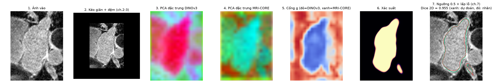

# GateFuse-LA: phân đoạn tâm nhĩ trái trên LGE-MRI bằng cách ghép có cổng DINOv3 và MRI-CORE

Dự án môn **Xử lý ảnh** (PTIT, Khoa Trí tuệ nhân tạo), *Lựa chọn 2 – dự án xử lý ảnh thực tế*.

Bài toán: cho một khối ảnh LGE-MRI tim (88 lát cắt ngang), sinh ra mặt nạ 3D của khoang **tâm nhĩ trái**.
Pipeline gồm: tiền xử lý cường độ (chương 2–3) → hai encoder nền tảng **đông cứng**
(DINOv3 ViT-B/16 học trên ảnh tự nhiên, MRI-CORE ViT-B/16 học trên ảnh MRI) → **cổng học được theo từng điểm ảnh**
quyết định tin encoder nào → decoder nhẹ → hậu xử lý hình thái (chương 7). Biến thể **D+** thêm một nhánh chi tiết
ở độ phân giải đầy đủ nhận ảnh và độ lớn gradient Sobel (chương 5) để bù độ thô của token ViT.
Phương pháp đối chứng: pipeline cổ điển Otsu + phép mở/đóng (chương 3, 5, 7) và U-Net 2D học từ đầu.

Báo cáo: [`report/main.pdf`](report/main.pdf) · Slide: [`slides/main.pdf`](slides/main.pdf) ([`.pptx`](slides/main.pptx)) · Video demo: [`results/demo_video.mp4`](results/demo_video.mp4)


*Pipeline trên một lát test: ảnh vào → kéo giãn + đệm → PCA đặc trưng DINOv3 / MRI-CORE → cổng g (đỏ: DINOv3, xanh: MRI-CORE) → xác suất → kết quả (xanh) so với nhãn (đỏ).*

## Kết quả (20 khối test, trung bình ± độ lệch chuẩn qua 3 seed)

**72 khối huấn luyện** (ngưỡng 0,5, chưa hậu xử lý)

| Phương pháp | Dice | Jaccard | HD95 (vox) | ASD (vox) |
|---|---|---|---|---|
| Cổ điển | 0.561 | 0.420 | 40.69 | 9.31 |
| U-Net | 0.912 ± 0.001 | 0.838 | 8.22 | 1.71 |
| DINOv3 | 0.902 ± 0.002 | 0.822 | 11.02 | 1.90 |
| MRI-CORE | 0.908 ± 0.001 | 0.832 | 7.82 | 1.66 |
| Ghép nối | 0.912 ± 0.001 | 0.839 | 8.13 | 1.64 |
| GateFuse | 0.911 ± 0.002 | 0.838 | 7.43 | 1.60 |
| D+ | 0.913 ± 0.001 | 0.840 | 7.52 | 1.57 |

**8 khối huấn luyện** (10% nhãn)

| Phương pháp | Dice | Jaccard | HD95 (vox) | ASD (vox) |
|---|---|---|---|---|
| U-Net | 0.828 ± 0.013 | 0.716 | 19.55 | 3.57 |
| DINOv3 | 0.849 ± 0.003 | 0.740 | 20.55 | 3.50 |
| MRI-CORE | 0.849 ± 0.002 | 0.744 | 13.85 | 2.80 |
| Ghép nối | 0.864 ± 0.003 | 0.762 | 14.75 | 2.86 |
| GateFuse | 0.857 ± 0.004 | 0.753 | 14.67 | 2.86 |
| D+ | 0.862 ± 0.009 | 0.761 | 14.23 | 2.80 |

Phát hiện chính:

* **MRI-CORE tốt hơn DINOv3** khi đủ nhãn (Dice 0,908 so với 0,902, Wilcoxon p = 0,036), và có biên tốt hơn rõ (HD95 7,8 so với 11,0 voxel).
* **Ghép hai encoder tốt hơn từng encoder** (GateFuse thắng MRI-CORE ở 16/20 ca, p = 0,001). Ghép có cổng và ghép nối cho Dice tương đương, nhưng cổng cho bản đồ giải thích được:
  g = 0,11 bên trong tâm nhĩ (dựa vào MRI-CORE), g = 0,69 ở nền xa (dựa vào DINOv3).
* **Khi chỉ có 8 khối có nhãn**, các đầu dùng đặc trưng nền tảng vượt U-Net học từ đầu khoảng 3 điểm Dice (D+ 0,862 so với 0,828, p = 0,004). Khi đủ 72 khối, U-Net bắt kịp.
* **Hậu xử lý hình thái** (thành phần liên thông 3D lớn nhất + đóng + lấp lỗ, chọn trên tập validation) giảm HD95 17–36%. Pipeline cuối D+ đạt Dice 0,915 (72 khối) và 0,872 (8 khối).
* Pipeline cổ điển thuần (Otsu + phép mở, đã dò 286 bộ tham số) chỉ đạt 0,561: phân ngưỡng cường độ không tách được máu trong nhĩ khỏi các cấu trúc lân cận.


HD95 và ASD tính bằng voxel (1 voxel = 0.625 mm). Bảng đầy đủ trong `results/tables/`, hình trong `results/figures/`.

## Cấu trúc thư mục

```
code/
  config.py            đường dẫn và hằng số (khung 256, ảnh vào encoder 512, lưới 32x32)
  data_prep.py         bước 1: cắt lát, kéo giãn tương phản theo phân vị, đệm vào khung 256
  encoders.py          nạp DINOv3 (timm) và MRI-CORE (checkpoint teacher -> ViT-B/16 của timm)
  extract_features.py  bước 2: chạy mỗi encoder một lần, lưu đặc trưng 768x32x32 (float16)
  models.py            đầu ghép A-D, D+ (DINOv3 / MRI-CORE / ghép nối / GateFuse / GateFuse+Sobel) và U-Net 2D
  train.py             bước 3: huấn luyện một cấu hình, một seed; ghi dự đoán val/test
  classical.py         đối chứng cổ điển: Gauss -> Otsu -> phép mở -> TPLT -> đóng + lấp lỗ
  postprocess.py       bước 4: hậu xử lý hình thái (TPLT 3D lớn nhất, lấp lỗ, phép đóng)
  metrics.py           Dice, Jaccard, HD95, ASD trên khối 3D
  evaluate.py          bước 5: đánh giá mọi lượt chạy (Dice, Jaccard, HD95, ASD, sai số thể tích), kiểm định Wilcoxon
  analysis.py          phân tích vị trí lỗi (gần biên / ở đầu-cuối tâm nhĩ)
  benchmark.py         đo thời gian huấn luyện và suy luận trên GPU rảnh
  figures.py           bước 6: hình cho báo cáo và slide
  make_tables.py       bảng LaTeX + numbers.tex (mọi con số trong báo cáo lấy từ đây)
  make_samples.py      ảnh mẫu trong samples/
  demo.py              chạy toàn bộ pipeline trên một lát PNG hoặc một khối .h5
  make_video.py        video demo ngắn (results/demo_video.mp4)
  make_pptx.py         xuất slide PDF sang .pptx
samples/               8 lát test (ảnh + nhãn) và 1 khối .h5 đầy đủ để chạy demo
results/
  tables/              CSV + LaTeX của mọi kết quả
  figures/             hình PDF/PNG
  checkpoints/         trọng số đầu GateFuse (seed 0, 72 khối) dùng cho demo
report/                báo cáo LaTeX (main.tex, main.pdf)
slides/                slide Beamer (main.tex, main.pdf, main.pptx)
run_all.sh             chạy lại toàn bộ thí nghiệm từ đầu
build_docs.sh          biên dịch báo cáo, slide (tectonic) và xuất .pptx
make_submission.sh     đóng gói LopXX_NhomYY_GateFuseLA.zip theo quy định nộp bài
```

## Môi trường và cài đặt

Python 3.12. Đã chạy trên Apple M2 Pro (GPU tích hợp, PyTorch MPS), 32 GB RAM; code tự chọn `mps`, `cuda` hoặc `cpu`.

```bash
python3.12 -m venv .venv && source .venv/bin/activate
pip install -r requirements.txt          # Linux/Windows: cài bản torch CUDA từ pytorch.org trước
```

## Dữ liệu và trọng số

* **Dữ liệu**: 100 khối có nhãn của *2018 Atrial Segmentation Challenge* (Xiong và cs., MedIA 2021),
  bản `.h5` đã cắt quanh tâm nhĩ do kho mã UA-MT phân phối: <https://github.com/yulequan/UA-MT/tree/master/data>.
  Chỉ cần tải thư mục `data/`:
  ```bash
  export LA_WORK=$(pwd)/work
  git clone --depth 1 --filter=blob:none --sparse https://github.com/yulequan/UA-MT.git $LA_WORK/data/uamt_src
  git -C $LA_WORK/data/uamt_src sparse-checkout set data
  ```
  Dữ liệu chỉ dùng cho mục đích học tập/nghiên cứu theo điều khoản của ban tổ chức cuộc thi.
* **DINOv3 ViT-B/16**: tự tải qua `timm` (`vit_base_patch16_dinov3.lvd1689m`) lần chạy đầu, theo giấy phép DINOv3 của Meta.
* **MRI-CORE ViT-B/16** (Apache-2.0, <https://github.com/mazurowski-lab/mri_foundation>):
  ```bash
  gdown 1nPkTI3H0vsujlzwY8jxjKwAbOCTJv4yW -O $LA_WORK/weights/mricore/MRI_CORE_vitb.pth
  ```

Mọi dữ liệu lớn (lát đã xử lý, đặc trưng khoảng 28 GB, checkpoint, dự đoán) nằm trong `$LA_WORK` (mặc định `./work`, không đưa lên git).

## Lệnh chạy

Chạy lại toàn bộ (tải dữ liệu, trích đặc trưng, 36 lượt huấn luyện, đánh giá, hình, bảng):

```bash
LA_WORK=$(pwd)/work bash run_all.sh
```

Hoặc từng bước:

```bash
python code/data_prep.py                                   # 8 800 lát -> work/prep
python code/extract_features.py --encoder dinov3           # ~10 phút trên M2 Pro
python code/extract_features.py --encoder mricore          # ~10 phút
python code/classical.py                                   # đối chứng cổ điển + dò tham số
python code/train.py --model gate --labels full --seed 0   # model: gate|gatedge|dinov3|mricore|concat|unet; labels: full|few
python code/evaluate.py && python code/analysis.py && python code/benchmark.py
python code/figures.py && python code/make_tables.py
bash build_docs.sh                                         # báo cáo + slide (cần tectonic)
bash make_submission.sh Lop01 Nhom05                       # file zip nộp bài
```

**Đầu ra mong đợi**: `work/runs/<model>_<labels>_s<seed>/` chứa `best.pt`, `history.csv`, `pred_test.npz`;
`results/tables/summary.csv` chứa Dice/Jaccard/HD95/ASD; `results/figures/` chứa các hình của báo cáo.

## Demo trên ảnh thật

```bash
# một lát: lưu hình 7 bước của pipeline vào results/figures/demo_<tên>.png
python code/demo.py --image samples/UPT6DX9I_z52_img.png --mask samples/UPT6DX9I_z52_mask.png
# một khối 3D đầy đủ: in Dice/HD95 nếu file có nhãn, lưu mặt nạ và ảnh ghép
python code/demo.py --h5 samples/volume_UPT6DX9I.h5
```

Demo dùng trọng số đầu GateFuse trong `results/checkpoints/gatefuse_full_s0.pt` và cần hai encoder ở trên.

## Khai báo sử dụng AI

Mã nguồn, thí nghiệm, báo cáo và slide của dự án được thực hiện với sự hỗ trợ của trợ lý AI Claude (Anthropic) qua Claude Code;
chi tiết ở mục *Khai báo sử dụng AI* trong báo cáo. Nhóm chịu trách nhiệm kiểm tra và hiểu toàn bộ nội dung trước khi nộp.

## Tài liệu tham khảo chính

* Siméoni và cs., *DINOv3*, arXiv:2508.10104, 2025.
* Dong và cs., *MRI-CORE: A Foundation Model for Magnetic Resonance Imaging*, arXiv:2506.12186, 2025.
* Xiong và cs., *A global benchmark of algorithms for segmenting the left atrium from LGE-MRI*, Medical Image Analysis 67, 2021.
* Yu và cs., *Uncertainty-aware self-ensembling model for semi-supervised 3D left atrium segmentation*, MICCAI 2019.
